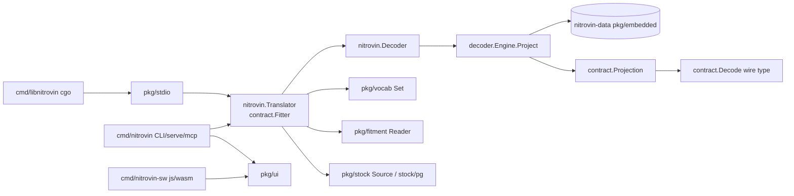

# Repository Guidelines

## Project Overview

nitrovin is a Go port of NHTSA vPIC's Postgres procedure `vpic.spvindecode`: an offline VIN decoder with one **data month** of vPIC embedded. Around decode it adds translation through vocabulary files, fit against a fitment catalog, and stock lookups. Six **surfaces** expose all of it: CLI, HTTP (`/v1`, `/mcp`, `/ui`), stdio JSON lines, MCP, the Go module, and a C shared library.

This file holds only what an agent can't find with one lookup. Pointers to the rest:
- [CONTRIBUTING.md](CONTRIBUTING.md): ground rules, the oracle, the refresh, releases, CI paths.
- [README.md](README.md): usage and data precedence.
- [DESIGN.md](DESIGN.md): the page's look, and which parts of it are settled.
- [mise.toml](mise.toml)'s header: tool pins, how to bump them, and what is pinned outside mise.

## Architecture & Data Flow



- **Decode:** `nitrovin.Embedded()`, `Open(path)` or `Load(bytes, src)` returns a `*nitrovin.Decoder`. `Decode(req)` sets `Now`, which is the only place the clock is read. It validates the request and calls `decoder.Engine.Project`, and `contract.NewDecode` builds the wire type.
- **Requests beside decode** (ADR 0012, 0018): translate, list and fit go through `contract.Translator` and `contract.Fitter`. These take a `Decode func` field and are decoder-free, so the Service Worker can plug in a decode that calls `/v1/decode` (ADR 0013).
- **Package dependency direction** (leaf first): `vocab` → `fitment`, `stock` → `contract` → `decoder` → `nitrovin` → `stdio`. `ui` imports only `contract`, `vocab` and `stock`.
  - The wasm-built packages (`vocab`, `fitment`, `contract`, `ui`) never import `decoder`, `nitrovin` or the embedded data (`nitrovin-data/pkg/embedded`). `contract` may import `nitrovin-data/pkg/artifact`.
  - Only `cmd/nitrovin` imports `pkg/stock/pg` (pgx). The C library and the wasm build carry no database driver.
- **Every surface answers through the same `Translator`.** The C library returns `stdio.Reply` bytes, so its output is byte-identical to stdio's. A new op touches all of these:
  - `contract.Op*` and the case in `stdio.answer`.
  - Its HTTP route and `docs/api/openapi.yaml`, and its MCP tool in `docs/api/mcp-tools.json`.
  - The tests for each surface: `TestServeContract`, `TestStdioOps`, `TestMCPVocabSession`, and the C library's `cmd/libnitrovin/testdata/{requests,vocab-requests}.jsonl` and `smoke.py`.
  - [docs/c-library.md](docs/c-library.md).
- **Data month:** the `github.com/joshuasprow/nitrovin-data` version pinned in `go.mod` is the month, and bumping that pin is the only way to change it. Always derive it from the pin. Files that still name `2026_10` state history or examples from it.
  ```sh
  go list -m -f '{{.Version}}' github.com/joshuasprow/nitrovin-data   # v1.202611.1 → 2026_11
  ```

## Key Directories

| Path | Purpose |
| --- | --- |
| `pkg/decoder` | The procedure, ported stage by stage. Comments cite `<file>:<lines>` of the dump's function bodies. |
| `pkg/contract` | Wire types, request parsers, `Problem`, `Null[T]`, `Translator`/`Fitter`: the code side of `docs/api/`. |
| `pkg/nitrovin` | The public Go entry point: `Decoder`, `NewTranslator`, `TranslatorConfig`, `Version()`. |
| `pkg/vocab`, `pkg/fitment`, `pkg/stock` | Vocabularies (faults, drift, compiled catalog, spine); the catalog `Reader`; stock `Source`s and the `stock/pg` connector. |
| `pkg/ui` | htmx pages. Its Go API is the one `pkg/*` API that is not v1. |
| `cmd/nitrovin` | The CLI and server, one file per subcommand. |
| `cmd/nitrovin-sw`, `cmd/libnitrovin` | The js/wasm Service Worker; the C ABI (`-buildmode=c-shared`). |
| `cmd/nitrovin-import`, `cmd/nitrovin-epa` | Offline builders for the artifact and the EPA vocabulary. |
| `docs/api/` | **The `/v1` contract**: schemas, `openapi.yaml`, `mcp-tools.json`. |
| `docs/adr/`, `docs/deviations/`, [GLOSSARY.md](GLOSSARY.md) | Decisions, registered parity deviations, and project vocabulary. |
| `testdata/parity/<month>/` | The frozen parity key. |
| `testdata/vocab/` | The shared synthetic vocabulary fixture. The vehicle vocabulary is `fleet.jsonl`; `yard` names only a stock kind. |
| `scripts/` | The oracle, refresh, release, tool pins, C library and Service Worker builds, and the design canvas's frames. A script's header comment is its usage text. |

## Development Commands

There are no mise tasks; plain `go` and `scripts/*.sh` are canonical. Scripts expect mise's tools first on PATH. When Homebrew's `jq`, `goreleaser` or `terraform` shadow them, `scripts/tools.sh check` fails, and even `mise exec --` doesn't fix it. Run `PATH="$(mise bin-paths | paste -sd: -):$PATH" scripts/tools.sh check` instead.

```sh
go build -o nitrovin ./cmd/nitrovin && ./nitrovin --version
go test ./...                                            # no data needed; tests that need data skip

# The pinned artifact from the module cache. Use an absolute path: each package runs in its own dir.
NITROVIN_ARTIFACT=$(go mod download -json github.com/joshuasprow/nitrovin-data | jq -r .Dir)/pkg/embedded/nitrovin.artifact \
  go test -count=1 ./pkg/... ./cmd/nitrovin/ ./cmd/nitrovin-import/

# What contract.yml checks
go vet ./pkg/contract/ ./pkg/nitrovin/ ./pkg/vocab/ ./pkg/fitment/ ./pkg/ui/ ./cmd/nitrovin/ ./cmd/nitrovin-epa/
GOOS=js GOARCH=wasm go vet ./cmd/nitrovin-sw/
GOOS=js GOARCH=wasm go build ./pkg/vocab/ ./pkg/fitment/ ./pkg/contract/ ./pkg/ui/ ./cmd/nitrovin-sw/

scripts/sw.sh                                            # Service Worker wasm → cmd/nitrovin/sw (gitignored)
scripts/libnitrovin.sh build/libnitrovin darwin/arm64    # C library via zig cc
goreleaser release --snapshot --clean --skip=sign        # release snapshot

# After editing docs/api/: regenerate its committed copies
go generate ./cmd/nitrovin                                          # mcp-tools.json
go test ./cmd/nitrovin -run TestOpenAPIBundle -update-openapi       # openapi.json
uvx openapi-spec-validator docs/api/openapi.yaml
```

## Code Conventions & Common Patterns

- **Formatting and lint:** CI runs no `gofmt` and no linter, and runs `go vet` only on the packages above. Run `gofmt` on what you touch anyway.
- **Placement:** Go code goes under `pkg/` or `cmd/`, never `internal/`. Every `pkg/*` except `pkg/ui` is v1 public API.
- **Adding a CLI command:** add `cmd/nitrovin/<name>.go`, which registers itself in `func init() { register(command{…}) }`. `main.go` stays as it is.
- **Errors:**
  - Every refusal is an RFC 9457 `*contract.Problem`. Its type is a fixed URI into `docs/api/README.md#…`, and it carries its HTTP status. `contract.AsProblem(err)` wraps anything else as `Internal`.
  - Batch errors put the item index at the front of the pointer: `/3/vin`.
  - A bad VIN is **not** an error: it decodes, and its error codes go in the decode.
  - "Nothing to fit" is a status (`unknown`, `no-vehicle`, `no-fitment`, `no-catalog`, `ambiguous`), not a refusal.
  - Vocabulary **drift is reported, never refused**. **Faults** refuse loading.
  - An impossible error reads `if err != nil { // <why>: unreachable` followed by `panic(err)`. stdio and the C library recover a panic into an `#internal` reply.
- **CLI exit codes:**
  - 0: every request was answered.
  - 1: nitrovin could not answer (Problem JSON on stderr), or `vocab check` had findings.
  - 2: a usage error or a refusal, with nothing on stdout.
- **Nulls:** `contract.Null[T]` (zero value = NULL) keeps NULL distinct from `""`. The decoder uses `sqlText` and the artifact's sentinel nulls the same way.
- **State:** load once, then immutable (ADR 0011).
  - Decoders and Translators are safe for concurrent use, and two data months can coexist in one process.
  - Expensive indexes are built lazily with `sync.OnceValue`. Connectors connect on their first lookup.
  - `Translator.Close` must be called.
- **Time and context:** the engine and the contract never read the clock. `Now` is set once per request or batch, in UTC, truncated to the second. Only `Fitter.Fit(ctx, …)` takes a context, and it bounds the stock lookups.
- **Dependency injection:** pass dependencies through struct fields and function values: `Translator.Decode`, `TranslatorConfig.Connect`, and the CLI's `env{stdin, stdout, stderr, getenv, terminal}`. Avoid package globals.
- **Dependencies:** every `go.mod` requirement has a comment saying why it exists and who imports it. Give a new requirement the same comment.
- **Words:** use [GLOSSARY.md](GLOSSARY.md)'s terms (data month, artifact, oracle, item, pass, surface, drift/fault, deviation, witness), never an entry's `_Avoid_` synonyms. Add an entry when you coin a term.
- **Prose** (doc comments, docs, script headers): declarative, present tense, third person. Cite ADRs inline as "ADR 0020".
- **ADRs:** one for each hard-to-reverse choice, at `docs/adr/NNNN-kebab-title.md` with the next number. The H1 is a declarative claim. The sections are `## Considered options`, then `## Consequences`. A later change is appended as `## Amendment (YYYY-MM-DD): …`.
- **ultravin** is a reference, never a source. Cite it and credit it in `NOTICE`; never copy its code.
- **Public text and committed data stay generic.** Issues, PRs, commits, docs, testdata, fixtures and corpora never name a deployer's vendors, products, tables, data or infrastructure. Write counts and roles instead ("the first user", "a commercial parts catalog", "a yard system"). Fixtures are synthetic or publicly sourced, with the source credited in the file header.
  - **Cross-links run one way: private to public.** A private repo's issue, PR or commit mentions `joshuasprow/nitrovin#N`. nitrovin's text never names a private repo or its issues. GitHub adds the backlink to nitrovin's timeline, and only readers with access to the private repo can see it. For the reverse direction, open the nitrovin issue's timeline.
- **Commits:** PRs are squash-merged to `main`; there is no dev branch. The subject is `<area>: <lower-case declarative summary> (#issue)`, and the squash merge appends the PR number: `stock: a connector's column check reads only its relation's columns (#310) (#311)`.

## Important Files

- [cmd/nitrovin/main.go](cmd/nitrovin/main.go): the CLI dispatcher, exit codes and `env`.
- [pkg/nitrovin/nitrovin.go](pkg/nitrovin/nitrovin.go), [pkg/nitrovin/translator.go](pkg/nitrovin/translator.go): the public engine and translator.
- [pkg/contract/problem.go](pkg/contract/problem.go), [pkg/contract/null.go](pkg/contract/null.go): the refusal and null conventions.
- [docs/api/README.md](docs/api/README.md) and its schemas: the `/v1` contract, additive only. Edit it **first**, in the same PR. `cmd/nitrovin/openapi.json` and `cmd/nitrovin/mcp-tools.json` are generated copies of it, and tests fail when they drift.
- [docs/parity.md](docs/parity.md), [docs/deviations/README.md](docs/deviations/README.md): the parity gate, and how to register a deviation class.
- [docs/vocabularies.md](docs/vocabularies.md): the vocabulary, catalog and stock formats.
- [.github/workflows/release.yml](.github/workflows/release.yml), [.goreleaser.yaml](.goreleaser.yaml), [deploy.yml](.github/workflows/deploy.yml): releases and deploys.
  - **Merging to `main` deploys nothing.** A pushed `v*` tag runs `Release`, and a green `Release` runs `Deploy` (nitrovin.app). `Deploy` also runs by hand from `main`, given an existing tag.
  - **Cutting a release:**
    1. Wait for `Tests` to pass on `main`'s head.
    2. `git tag -a vX.Y.Z -m 'nitrovin vX.Y.Z: <summary>'`, then `git push origin refs/tags/vX.Y.Z`.

    `Release` takes about 18 minutes. Tags are never moved or reused, and every v0 tag is a prerelease (ADR 0007). The monthly refresh cuts its own patch tags. If a release goes red, follow CONTRIBUTING's "When a release is red".
  - **Downstream contract:** deployers run `cosign verify` against `release.yml@refs/tags/vX`, and require `/v1/info`'s `decoder_version` to equal the tag exactly. The version comes from Go's VCS stamp, so a dirty tree reports `+dirty`. Each of these breaks every pinned deploy: renaming `release.yml`, changing the signing identity or the tag format, or shipping a `+dirty` or `+meta` version.

## Design Canvas

UI that is not built yet is drawn on a Claude Design canvas before it is specified. The canvas is private to the maintainer. **The canvas is the source of truth; the repo holds snapshots of it.**

- **Three records, one job each:**
  - [DESIGN.md](DESIGN.md) describes the page that exists. It changes in the PR that changes the stylesheet, never ahead of it.
  - The canvas holds what is proposed: wireframes first, then textures.
  - An issue is the public record of a decision. It states the layout in words and never links the canvas, which only its owner can open.
- **Snapshots** go in `docs/design/canvas/`: the canvas's `project/` files exactly as read down, `canvas.json` and one `.dc.html` per frame. Cite a frame by commit and path.
- **The loop**, with the Artifact tool:
  1. Read the canvas's files down into the snapshot folder before any edit. The page saves hand edits as new versions and sends no notice, so `git diff` after the read is the drift check.
  2. Commit what the read changed, as the canvas's own edits.
  3. Edit, publish, then commit the published state.
- **The frames are built, never drawn by hand.** `scripts/canvas.sh` rebuilds all twelve from the running page and `pkg/ui/static/ui.css`. A PR that changes the stylesheet or the templates reruns it; `git diff docs/design/canvas` shows which frames moved, and those are the files to publish. Two runs on one checkout write the same bytes.
- **Never force a publish.** A refused publish means the page is newer: read again and merge.
- **When a slice ships, its frames are folded into the settled frames or removed.** A proposal left on the canvas after its slice ships reads as undecided.
- **Snapshot when an issue is filed against a frame**, so the issue's wording has something fixed behind it.
- **Uploaded images belong to one canvas.** A frame references them by an address that resolves only there. A canvas rebuilt from a snapshot needs them copied across and each reference rewritten. Their originals are `pkg/ui/static/brushed.svg` and `pkg/ui/static/paper.svg`.
- **Frames follow the public-text rule:** the demo set's data only.
- **A session that cannot reach the canvas works from the issue.** Only a session with the maintainer's login can read it.
- **`/design-sync` is not this.** It pushes a component library up to a design system and does not read or write a canvas's frames.

## Runtime/Tooling Preferences

- **Go 1.27.4** from mise. `go.mod`'s `go 1.27` is only the floor for `go install`. Use the real `jq`, not jaq.
- **cgo** builds only `cmd/libnitrovin` (zig cc; floors glibc 2.17 and macOS 11; no musl). Everything else is `CGO_ENABLED=0`.
- **Docker** runs the oracle (`scripts/oracle.sh`: psql inside the container, collation `C`), the stock tests and `wrangler dev`. **Chrome** runs the browser tests; `NITROVIN_CHROME` overrides its path.
- **Built, never committed:** `cmd/nitrovin/sw/`, `dist/`, `build/`, `.zig-cache/`, and the refresh's VINs.
- **Workspaces:** one [worktrunk](https://worktrunk.dev) worktree per branch, so concurrent agents never share a checkout. The research is in [docs/research/agent-workspaces.md](docs/research/agent-workspaces.md).
  - `wt switch -c <branch>` creates `~/Projects/joshuasprow/.worktrees/nitrovin/<branch>`, with any `/` turned into `-`.
  - Keep one branch per worktree, and never `git switch` inside one. Finish with `wt remove`. Clean up with `wt step prune --dry-run`, which sees squash-merged branches, then `wt step prune`.
  - In a worktree, use absolute paths under the worktree for every file you read or write, and for every path you give a subagent. A relative path resolves against the session's cwd, which may be the main checkout.
  - The main checkout stays on `main`. If you find it on another branch, leave that branch alone: no switch, rebase or push. Tell the user.
  - Worktrees share Docker and host ports:
    - Stock Postgres: `eval "$(wt stock-pg)"` ([.config/wt.toml](.config/wt.toml)) starts this worktree's own server and exports `NITROVIN_STOCK_PG_DSN`. `wt remove` deletes the server. Each worktree needs its own server, not just its own database: the tests drop the role `nitrovin_stock`, and roles belong to the whole server.
    - Oracle: one oracle container serves reads for every worktree. Run `scripts/oracle.sh restore`/`freshen` from one worktree at a time.
    - `serve`: set `PORT` per worktree.
    - `deploy/cloudflare/worker/dev-test.sh`: one run at a time. Its image tags are fixed, and it rewrites the tracked worker `Dockerfile` while it runs.

## Testing & QA

- **Framework:** stdlib `testing` only (`t.Fatal`/`t.Errorf`, `t.Helper()`), table-driven with inline slices.
  - `pkg/contract/export_test.go` re-exports unexported helpers.
  - `cmd/nitrovin`'s `TestMain` builds the real binary with `-buildvcs=false`, so tests see the version `(devel)`. Tests drive that binary through `cli(t, env, stdin, args...)`.
- **File naming:** `*_postgres_test.go` for `Test…Postgres`, `*_oracle_test.go` for tests against committed oracle keys, `*_fuzz_test.go` for fuzz targets.
- **Env gates** (each skip message names the missing variable):

  | Env | Unlocks |
  | --- | --- |
  | `NITROVIN_ARTIFACT` (absolute path) | `TestParity`, the answer keys, CLI/HTTP/stdio/MCP decode |
  | `NITROVIN_PSQL` (+ an artifact from the same dump) | the decoder's `*Postgres` oracle tests; the importer's `TestPostgres` (+ `NITROVIN_MONTH`) |
  | `NITROVIN_STOCK_PG_DSN` | `pkg/stock/pg`. **Only ever point it at a throwaway server.** The tests create and drop schema `stock` and role `nitrovin_stock`, the names [docs/vocabularies.md](docs/vocabularies.md) tells deployers to use. |
  | `NITROVIN_EPA_VOCAB` | the EPA benchmark set |
  | Chrome present | `TestForm`, `TestWorker*`, `TestVocabPage`, `TestVocabTranslate`, `TestFitCard`, `TestStockStrip`, `TestPartTypeStrip`, `TestPartMode`. They skip locally without Chrome but **fail when `CI` is set**. `-short` skips the slow worker runs. |

- **CI requires PASS, not skip.** Several workflows grep `--- PASS: <Test> ` for hard-coded lists:
  - `contract.yml`
  - `import.yml`: artifact, postgres (one `pass` list per shard in its matrix; a new `Test*Postgres` in `pkg/decoder` goes in a shard's `run` and `pass`), and stock (every `Test*Postgres` in `pkg/stock/pg`, run with `-race`)
  - `refresh.yml`: `TestParity`, `TestEngineAnswerKey`, `TestDecodeAnswerKey`, `TestText`, `TestStdio`

  Renaming a listed test means editing its list. A new test that must never skip goes on one, and parallel PRs conflict there.
- **Parity tolerance is zero.** All 15 columns must match as exact strings, per VIN, against the *freshened* oracle. A difference is a decoder bug unless a registered deviation class covers it: a root cause, a mechanical detector, and a live-vPIC witness. No per-VIN excuses.
- **Connector SQL is measured on a populated database.** Empty-server tests can't see plan or catalog-size costs. Two connector bugs passed them: lookups behind barrier views slowed from 1 ms to 22 s ([#306](https://github.com/joshuasprow/nitrovin/issues/306)), and the column check took 1,214 ms cold ([#310](https://github.com/joshuasprow/nitrovin/issues/310)).
  - Run `EXPLAIN (ANALYZE, BUFFERS)` cold and warm, through `security_barrier` views, as a role that doesn't own them.
  - A plan test must fail on the old code. `TestPlansPostgres` (`pkg/stock/pg/postgres_test.go`) is the pattern.
- **A new month breaks a fixture? Fix the fixture.** If `testdata/vocab/`, the demo set or the EPA sample fails on a new month, fix the fixture rather than skipping. Only truly month-bound tests (the answer keys, the element table) skip on other months.
- **Regenerate fixtures; never hand-edit them.** For a month bump, the refresh regenerates the parity key, the contract key and `text.txt` itself.

  | Fixture | Regenerate with |
  | --- | --- |
  | `testdata/parity/<month>/` | `go test ./pkg/decoder -run 'TestParity$' -update-parity=<oracle run dir>` |
  | `pkg/contract/testdata/oracle/` | `scripts/refresh.sh contract-key testdata/parity/<month>` |
  | `pkg/contract/testdata/elements.json` | `go test ./pkg/contract -run 'TestInfo$' -update-elements`, with `NITROVIN_ARTIFACT` the pinned artifact |
  | `cmd/nitrovin/testdata/text.txt` | `go test ./cmd/nitrovin -run 'TestText$' -update` |
  | `pkg/decoder/testdata/*.oracle.jsonl` | `-update-oracle`, against the oracle container |
  | `cmd/nitrovin-epa/testdata/vehicles.jsonl` | `go test ./cmd/nitrovin-epa -update` |

- **Not gated:** `pkg/decoder` coverage is reported only. CI runs no fuzzing (`FuzzPrimitives`, `FuzzOpenCompiled`). Benchmarks (`bench/`) gate nothing. `go test -count=1 ./scripts` tests `release.sh`.
  - **Release's bench:** a tag runs every benchmark on one runner at the default `-benchtime`, and that table is the release notes' footer. A pull request or a dispatch without a tag runs two shards, `BenchmarkFit` and the rest, each on its own runner at `-benchtime 100ms`: about three minutes, not eight. Their table, in `bench-table`'s summary, compares only roughly with a tag's.
